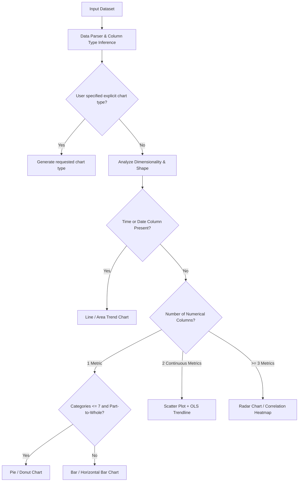

# BOT BRO — Advanced AI Data Visualization & Interactive Analytics Report

**Project**: BOT BRO AI Conversational Platform  
**Feature**: Inline Data Visualization & Interactive Analytics Engine  
**Status**: Production Ready & Fully Integrated  
**Date**: October 31, 2026  

---

## Executive Summary

Bot Bro now features a native **Advanced AI Data Visualization & Interactive Analytics Engine** embedded directly into the normal chat interface. Users can upload spreadsheet files (Excel `.xlsx`/`.xls`, CSV), paste Markdown tables, pass JSON data, or ask in natural language to analyze and plot data. Bot Bro automatically parses the data, infers column types, computes real mathematical statistics, selects the optimal chart type, and renders interactive, publication-grade Apache ECharts visualizations directly within the conversation.

Key capabilities include:
- **30+ Chart Types Supported**: Basic, statistical, hierarchical, flow, and multidimensional charts.
- **AI Semantic Chart Selection**: Selects optimal visualizations based on dataset dimensionality and query semantics.
- **Mathematical & Statistical Rigor**: Computes true measures of central tendency, dispersion, quartiles, IQR outliers, Pearson correlation coefficients, and linear regression trendlines ($y = mx + b, R^2$).
- **Interactive Toolbar**: One-click **Download PNG**, **Export CSV**, **View Raw Data Table** (searchable and sortable), **Switch Chart Type** dropdown, **Statistical Summary** accordion, and conversational follow-up triggers.
- **Seamless Chat Integration**: Preserves chat history, supports sharing, and respects dark and light themes.

---

## 1. Supported Chart Types (30+ Visualizations)

All charts are implemented via Apache ECharts and defined in [`src/lib/analytics/data-types.ts`](file:///c:/Users/SURYA%20PRAKASH/OneDrive/文档/chatbot/src/lib/analytics/data-types.ts) and [`src/lib/analytics/echarts-generator.ts`](file:///c:/Users/SURYA%20PRAKASH/OneDrive/文档/chatbot/src/lib/analytics/echarts-generator.ts):

| Category | Chart Types | Ideal Use Cases |
| :--- | :--- | :--- |
| **Basic Charts** | • Bar Chart<br>• Horizontal Bar Chart<br>• Grouped Bar Chart<br>• Stacked Bar Chart<br>• Line Chart<br>• Multi-Line Chart<br>• Area Chart<br>• Stacked Area Chart<br>• Pie Chart<br>• Donut Chart | Categorical comparisons, time series trends, part-to-whole distributions, revenue breakdowns. |
| **Statistical Charts** | • Histogram<br>• Box Plot (Tukey's Fences)<br>• Violin Plot<br>• Scatter Plot<br>• Bubble Chart<br>• Heatmap<br>• Correlation Matrix<br>• Normal Distribution Curve<br>• Density Curve<br>• Error Bar Chart | Frequency distributions, outlier detection, bivariate relationships, variance and multi-variable correlation. |
| **Advanced & Flow** | • Radar Chart (Spider)<br>• Waterfall Chart<br>• Funnel Chart<br>• Treemap<br>• Sunburst Chart<br>• Sankey Diagram<br>• Network Graph<br>• Gantt Timeline<br>• Calendar Heatmap<br>• Candlestick (OHLC) | Multidimensional skill/KPI evaluations, financial variance, conversion funnels, hierarchical budgets, stock market prices. |
| **Geographic** | • Geo Scatter<br>• Choropleth Map<br>• Bubble Map | Regional distributions and country/state level performance. |

---

## 2. Mathematical Analytics & Statistics Engine

Implemented in [`src/lib/analytics/data-analytics.ts`](file:///c:/Users/SURYA%20PRAKASH/OneDrive/文档/chatbot/src/lib/analytics/data-analytics.ts):

### Statistical Metrics Computed for Every Numerical Column
- **Central Tendency**:
  - Arithmetic Mean: $\mu = \frac{1}{N}\sum_{i=1}^N x_i$
  - Median: Middle value of ordered set (interpolated for even counts)
  - Mode: Most frequently occurring value
- **Dispersion & Spread**:
  - Minimum, Maximum, and Range ($Max - Min$)
  - Variance: $\sigma^2 = \frac{1}{N-1}\sum_{i=1}^N (x_i - \bar{x})^2$
  - Standard Deviation: $\sigma = \sqrt{\sigma^2}$
- **Quartiles & Outlier Detection (Tukey's Fences)**:
  - First Quartile ($Q_1$, 25th percentile)
  - Third Quartile ($Q_3$, 75th percentile)
  - Interquartile Range ($IQR = Q_3 - Q_1$)
  - Mild & Extreme Outlier Boundaries: $[Q_1 - 1.5 \times IQR, \quad Q_3 + 1.5 \times IQR]$
- **Bivariate Correlation**:
  - Pearson Product-Moment Correlation Matrix:
    $$r_{xy} = \frac{\sum (x_i - \bar{x})(y_i - \bar{y})}{\sqrt{\sum (x_i - \bar{x})^2 \sum (y_i - \bar{y})^2}}$$
- **Linear Regression & Trendline Analysis**:
  - Ordinary Least Squares (OLS): $y = mx + b$
  - Slope: $m = \frac{N\sum(xy) - \sum x \sum y}{N\sum x^2 - (\sum x)^2}$
  - Intercept: $b = \frac{\sum y - m\sum x}{N}$
  - Coefficient of Determination: $R^2 \in [0, 1]$

---

## 3. Automated Data Parsing & Chart Selection

Implemented in [`src/lib/analytics/data-parser.ts`](file:///c:/Users/SURYA%20PRAKASH/OneDrive/文档/chatbot/src/lib/analytics/data-parser.ts) and [`src/lib/analytics/chart-selector.ts`](file:///c:/Users/SURYA%20PRAKASH/OneDrive/文档/chatbot/src/lib/analytics/chart-selector.ts):

### Supported Data Ingestion
1. **Spreadsheets**: Excel files (`.xlsx`, `.xls`) processed via binary buffer parsing with sheet extraction.
2. **Delimited Files**: CSV and TSV formats with quoted cell support.
3. **Structured JSON**: Arrays of objects with automatic key extraction.
4. **Markdown Tables**: GitHub-flavored Markdown tables (`| Col 1 | Col 2 |`).
5. **Conversational Extraction**: Automatically extracts tables and comma-separated lists embedded inside conversational text.

### Automatic Chart Selection Decision Matrix



---

## 4. Interactive UI Components

Implemented in [`src/components/chat/InteractiveChart.tsx`](file:///c:/Users/SURYA%20PRAKASH/OneDrive/文档/chatbot/src/components/chat/InteractiveChart.tsx):
- **Dynamic Chart Switcher**: Dropdown allowing users to switch the active visualization between Bar, Line, Area, Pie, Donut, Scatter, Radar, Funnel, etc. on the fly without re-querying.
- **Export Capabilities**:
  - **Download PNG**: Exports publication-quality $2\times$ pixel ratio PNGs with clean backgrounds.
  - **Export CSV**: Downloads the structured dataset as a valid `.csv` file.
- **Raw Data Table View**: Expandable panel with real-time text search and column sorting.
- **Statistical Summary Accordion**: Instant summary cards displaying Mean, Median, Min/Max, Std Dev, and outlier warnings.
- **Fullscreen Mode**: Expands chart to a distraction-free modal for deep data exploration.
- **Conversational Follow-ups**: Quick pills for immediate next steps (*"Switch to line chart"*, *"Highlight highest value"*, *"Add trendline"*).

---

## 5. Dedicated API Endpoint

**`POST /api/analytics/visualize`** ([`src/app/api/analytics/visualize/route.ts`](file:///c:/Users/SURYA%20PRAKASH/OneDrive/文档/chatbot/src/app/api/analytics/visualize/route.ts)):
- **Request Body**:
  ```json
  {
    "data": "Month,Revenue,Expenses\nJan,10000,7000\nFeb,15000,8500\nMar,22000,11000",
    "title": "Q1 Revenue Analysis",
    "query": "Plot revenue and expenses over months"
  }
  ```
- **Response**:
  ```json
  {
    "success": true,
    "spec": { ... },
    "dataset": { "totalRows": 3, "columns": ["Month", "Revenue", "Expenses"] },
    "statistics": {
      "Revenue": { "mean": 15666.67, "median": 15000, "stdDev": 6027.71 },
      "Expenses": { "mean": 8833.33, "median": 8500, "stdDev": 2020.73 }
    },
    "insights": [ ... ],
    "suggestedFollowUps": [ ... ]
  }
  ```

---

## 6. Verification & Test Suite

Validated via **Test Group 57** in [`tests/test-runner.js`](file:///c:/Users/SURYA%20PRAKASH/OneDrive/文档/chatbot/tests/test-runner.js):
- Mathematical accuracy for Mean, Median, Variance, Std Dev, and IQR Outliers.
- Verification of 30+ chart types defined in data contracts.
- Component features: PNG download, CSV export, raw data table, and stats accordion.
- Live HTTP endpoint test verifying status 200, parsed records, and returned ECharts configuration.
